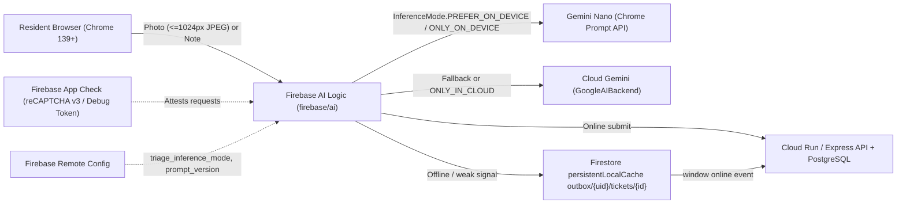

# Living Plus

**PG (paying-guest) living in Chennai, run end to end: honest discovery for guests, a simple home for residents, and a calm workspace for owners, with hybrid on-device + cloud Gemini AI doing the routine work and people approving anything that matters.**

---

## Hybrid AI with Firebase AI Logic (#BuildHybridAI 2026)

PG hostel residents in Indian cities routinely lose cellular signal inside interior bedrooms, basements, and concrete stairwells — exactly where leaky pipes and sparking switches happen. **LivingPlus** puts **Gemini Nano on-device** (via Firebase AI Logic `firebase/ai` and Chrome's Prompt API) inside the resident's browser so **Snap & Triage** maintenance reporting and **VibeCheck** habit extraction work privately, instantly, and even completely offline, backed by a **Cloud Firestore offline outbox**. When cross-ticket reasoning or multimodal scale is needed, Firebase AI Logic routes cleanly to **Cloud Gemini**, guarded by **Firebase App Check** and steered live via **Firebase Remote Config**.

### Hybrid Architecture



### Hybrid Feature Matrix

| Feature | Firebase AI Logic Mode | Primary Function & File | Privacy / Resilience Behavior |
|---|---|---|---|
| **Snap & Triage (Maintenance)** | `InferenceMode.PREFER_ON_DEVICE` (configurable via Remote Config) | [`triageMaintenanceIssue`](Project/frontend/src/ai/ai.ts) called in [`ResidentMaintenanceView.tsx`](Project/frontend/src/features/resident/ResidentMaintenanceView.tsx) | Downscales photos client-side (`<=1024px` JPEG via [`downscaleImageToJpeg`](Project/frontend/src/ai/image.ts)), forces `URGENT` when `safetyRisk: true`, badges `"Analysed on your device 🔒"` vs `"Analysed in the cloud ☁️"` + ms latency. |
| **Offline Maintenance Outbox** | Works offline with Firestore Local Persistence | [`queueOfflineTicket`](Project/frontend/src/ai/outbox.ts), [`useOfflineTicketOutbox`](Project/frontend/src/ai/outbox.ts), [`firestore.rules`](firestore.rules) | Queues triaged tickets + JPEG under `outbox/{firebaseUid}/tickets/{id}` with Anonymous Auth; auto-flushes and toasts on reconnection. |
| **Private On-Device VibeCheck** | `InferenceMode.ONLY_ON_DEVICE` | [`extractVibeHabitsOnDevice`](Project/frontend/src/ai/ai.ts) called in [`VibeProfileBuilder.tsx`](Project/frontend/src/components/VibeProfileBuilder.tsx) | Turns free-text lifestyle notes into 8 numeric habit indices on-device so raw words never leave Chrome; falls back to `/pg/vibecheck/profile` with notice if unavailable. |
| **Owner Open-Ticket Digest** | `InferenceMode.ONLY_IN_CLOUD` | [`summarizeOwnerOpenTickets`](Project/frontend/src/ai/ai.ts) called in [`OperationsViews.tsx`](Project/frontend/src/features/owner/OperationsViews.tsx) | Summarizes all open & in-progress maintenance tickets across rooms into 3 actionable bullets and detects repeated building issues. |
| **App Check & Remote Config + Debug Drawer** | Live mode switching & attestation | [`ensureAppCheck`](Project/frontend/src/ai/app-check.ts), [`initHybridRemoteConfig`](Project/frontend/src/ai/remote-config.ts), [`HybridAiDebugPanel`](Project/frontend/src/ai/HybridAiDebugPanel.tsx) | Append `?debug=ai` to any URL to inspect Gemini Nano status, trigger user-gesture warmup (`initializeDeviceModel`), flip `InferenceMode`, and read live latency telemetry. |

### Run & Test Hybrid AI Locally

1. **Configure Frontend Environment (`Project/frontend/.env`):**
   ```bash
   cp Project/frontend/.env.example Project/frontend/.env
   ```
   Fill in your Firebase Web App keys (`VITE_FIREBASE_API_KEY`, `VITE_FIREBASE_AUTH_DOMAIN`, `VITE_FIREBASE_PROJECT_ID`, `VITE_FIREBASE_APP_ID`), reCAPTCHA v3 site key (`VITE_RECAPTCHA_SITE_KEY`), and keep `VITE_APPCHECK_DEBUG=true` for local testing.
   - When running in local development, Firebase prints an **App Check debug token** in the browser DevTools console — register that UUID once in *Firebase Console → App Check → Apps → Manage debug tokens* (or pass your pre-registered UUID directly in `VITE_APPCHECK_DEBUG`).

2. **Enable On-Device Gemini Nano (Chrome Desktop 139+):**
   - Open `chrome://flags/#optimization-guide-on-device-model` → set to **Enabled BypassPerfRequirement**
   - Open `chrome://flags/#prompt-api-for-gemini-nano` → set to **Enabled** (and multimodal input if available)
   - Relaunch Chrome, open `chrome://on-device-internals` → ensure the Optimization Guide on-device model is downloaded, or open LivingPlus (`?debug=ai`) and click **"Initialize on-device AI"** (or **"Enable offline AI"** in Resident Maintenance) — Chrome requires a user gesture to trigger `model.initializeDeviceModel()`.

3. **Test Offline Snap & Triage + Firestore Outbox:**
   - Sign in as a resident (`/stay/<pg-slug>/maintenance`) and open **Report an issue**.
   - In Chrome DevTools → **Network** → select **Offline**.
   - Snap a photo or type `"sparking switch near bathroom geyser"` and click **Triage**. Gemini Nano runs offline on-device, flags `safetyRisk: true`, and sets priority to `URGENT`.
   - Click **Queue offline report** — it appears immediately with `"Queued, will send when you're back online"`.
   - Switch DevTools **Network** back to **No throttling** — LivingPlus automatically flushes the Firestore outbox and toasts `"1 offline report sent"`.

### Built During the Submission Period (Nov 11 – Nov 30, 2026)

LivingPlus began as an existing PG marketplace, resident portal, and owner operations platform (including backend PostgreSQL ledger, Google ADK server agent, KYC checks, Deposit Shield, and Live API voice VibeCheck). Specifically built during **#BuildHybridAI 2026 (Nov 11 – Nov 30, 2026)**:
- `Project/frontend/src/ai/` (`firebase.ts`, `app-check.ts`, `remote-config.ts`, `device-model.ts`, `image.ts`, `prompts.ts`, `ai.ts`, `outbox.ts`, `HybridAiDebugPanel.tsx`) using `firebase/ai` (`InferenceMode`, `InferenceSource`, `GoogleAIBackend`, `initializeDeviceModel`), `firebase/app-check`, `firebase/remote-config`, and `firebase/firestore` (`persistentLocalCache()`).
- **Snap & Triage** multimodal camera/text triage, client-side JPEG downscaling (`<=1024px`), safety hazard escalation (`URGENT`), and **Firestore Offline Outbox** in `ResidentMaintenanceView.tsx` + backend support for resident `priority` and `imageUrl` in `maintenance.controller.ts`.
- **On-Device Private VibeCheck** mode (`ONLY_ON_DEVICE`) in `VibeProfileBuilder.tsx`.
- **Owner Open-Ticket Cloud Digest** (`ONLY_IN_CLOUD`) in `OperationsViews.tsx`.
- `LICENSE` (Apache-2.0), `firestore.rules`, `Project/frontend/.env.example`, `?debug=ai` inspector, unit tests, `SUBMISSION.md`, and `DEMO_SCRIPT.md`.

---

## Three sites, one codebase

| Site | Path | Who | What they do |
|---|---|---|---|
| Guest | `/` | Students and young professionals looking for a PG | Browse with no sign-up. See the real monthly cost (rent, food, deposit), live bed availability, and how far each PG is from their campus or office (IIT Madras, Tidel Park, SIPCOT…). Take **VibeCheck** to see how they'd fit with each room. Request a bed with one phone code, then follow the reply in *My requests*. |
| Resident | `/stay/<pg>` | People living in a PG | See what they owe and pay, report issues with **Snap & Triage** (on-device + offline queue) or voice, order meals and cleaning, keep move-in condition records, update VibeCheck, request a room change, and read notices. |
| Owner | `/owner` | PG owners and their staff | *Today* (what needs you), beds and bookings, tenants and KYC, the rent ledger and payment claims, expenses, utilities, maintenance (with Cloud Gemini daily digests), services, staff roles and reports. |

## AI: the right Google tool for each job

| Job | Built with | How |
|---|---|---|
| Resident Snap & Triage + Offline Outbox | **Firebase AI Logic** (`firebase/ai`, `PREFER_ON_DEVICE`) + **Firestore** + **App Check** + **Remote Config** | Runs single-turn structured image/text maintenance triage on Chrome's Gemini Nano with automatic Cloud Gemini fallback, safety-hazard `URGENT` escalation, and Firestore persistent offline queueing. |
| Private Resident VibeCheck Text Extraction | **Firebase AI Logic** (`firebase/ai`, `ONLY_ON_DEVICE`) | Maps personal lifestyle paragraphs into 8 numerical habit indices without sending the resident's raw words off-device. |
| Owner Cross-Ticket Digest | **Firebase AI Logic** (`firebase/ai`, `ONLY_IN_CLOUD`) | Summarizes today's open tickets and repeated cross-room patterns for owners/wardens. |
| Assistant for guests, residents and owners (~30 tools) | **Google ADK** (`@google/adk`) | Server-side `LlmAgent` with role- and property-scoped `FunctionTool`s and DB-backed confirmations for writes. |
| KYC document check, Deposit Shield, Kitchen Forecast | **Gemini API** (`@google/genai`) | Structured server-side vision checks (ID last-4 extraction, paired move-in/out damage comparison, meal forecasting). |
| VibeCheck Live & Owner Briefings | **Gemini Live API** | Low-latency 16 kHz AudioWorklet voice conversation in Tamil, Hindi or English. |

**Guardrails:**
- On-device VibeCheck text stays strictly in the browser when Gemini Nano is active; matching shares only habit indices, never names or phones.
- The KYC check keeps only the last 4 digits of an ID number.
- Firestore outbox security rules restrict each resident session strictly to `outbox/{uid}/tickets/{ticketId}`.
- Each backend assistant tool enforces role and property row-level isolation.

## On Google Cloud

| Need | Service |
|---|---|
| Web app and API | **Cloud Run** (one container, scales to zero) |
| Data | **Cloud SQL for PostgreSQL** (row-level security per PG) & **Cloud Firestore** (offline resident maintenance outbox) |
| Client Hybrid AI, Attestation & Config | **Firebase AI Logic**, **Firebase App Check**, **Firebase Remote Config** |
| Uploads (photos, KYC, condition records) | **Cloud Storage**, private, served through short-lived signed URLs |
| Server AI & Secrets | **Vertex AI** (Gemini, embeddings) + **Secret Manager** |
| Phone OTP and Sign-In | **Firebase Authentication** (Phone OTP, Google Sign-In, Anonymous Auth for outbox rules) |

## Deploy

From the repository root, signed in with `gcloud`:

```bash
# Vertex AI on the project (default)
PROJECT_ID=<project> SEED_DEMO_DATA=1 bash deploy/gcp-deploy.sh

# Fresh project without Firebase: on-screen OTP codes
PROJECT_ID=<project> SEED_DEMO_DATA=1 SKIP_FIREBASE=1 bash deploy/gcp-deploy.sh

# See every step without changing anything
DRY_RUN=1 PROJECT_ID=<project> SKIP_FIREBASE=1 bash deploy/gcp-deploy.sh
```

## Run locally

```bash
cd Project/backend && cp .env.example .env    # set GOOGLE_API_KEY and ENABLE_AI_ORCHESTRATOR=true for server AI
npm install && npm run dev                     # starts a local PostgreSQL, applies migrations, runs the API
npm run seed                                   # demo PGs, rooms and residents

cd ../frontend && cp .env.example .env         # add VITE_FIREBASE_* & VITE_RECAPTCHA_SITE_KEY
npm install && npm run dev                     # http://localhost:5173
```

## Tests

```bash
cd Project/backend  && npm test                # API, isolation, invoice-code and AI-agent tests
cd Project/frontend && npm test && npm run e2e # Unit tests (incl. Firebase AI Logic & outbox) + Playwright E2E
```

## License

Apache License 2.0 — see [`LICENSE`](LICENSE).
