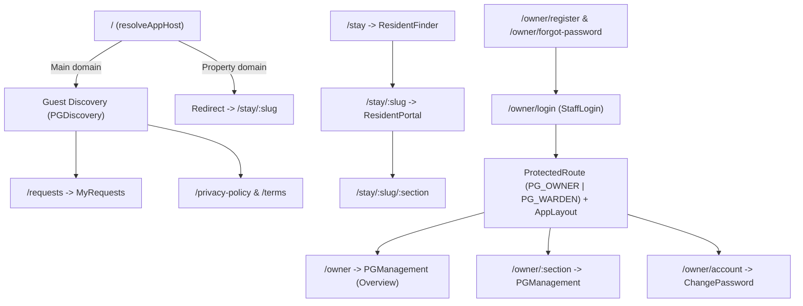
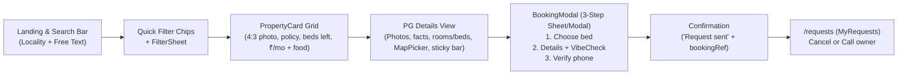

# LivingPlus — Website Design System & Complete Application Flow

> **Purpose:** Complete analysis of the LivingPlus web application's visual system, typography, routes, end-to-end user flows, and component architecture across all three sites (**Guest**, **Resident**, **Owner/Warden**). Use this alongside [DESIGN.md](file:///home/gokul/livingplus/DESIGN.md) to review the current UI or plan targeted improvements.

---

## 1. Visual Design System & Typography

All visual tokens are defined in [index.css](file:///home/gokul/livingplus/Project/frontend/src/index.css) using Tailwind v4 `@theme`.

### 1.1 Colour Palette & Semantic Tokens

| Token | Hex | Usage | Notes |
|---|---|---|---|
| `--color-navy-900` | `#02224B` | Brand primary, headings (`h1`–`h3`), top bars, selected states, `:focus-visible` ring | 15.8:1 contrast on white |
| `--color-navy-700` | `#0A3B75` | Links, hover states on navy, info text | 11.1:1 contrast on white |
| `--color-ink` | `#24364F` | Default body text | 12.2:1 contrast on white |
| `--color-muted` | `#5A6B82` | Secondary text, captions, helper text | 5.4:1 on white, 5.1:1 on surface |
| `--color-field-border` | `#7A8AA0` | Input, select, and checkbox borders | Meets 3:1 interactive element contrast |
| `--color-hairline` | `#E2E7EE` | Card borders and dividers | Decorative only |
| `--color-canvas` | `#FFFFFF` | Guest site background, cards, modals, sheets | — |
| `--color-surface` | `#F5F7FA` | Resident & Owner workspace page background | Cards sit on top in `#FFFFFF` |
| `--color-amber-500` | `#FEB109` | **Primary CTA fill only** (`btn-primary` / `btn-accent`) | Text on amber is always `navy-900` (8.6:1) |
| `--color-amber-600` | `#E39E00` | Primary CTA hover/pressed | — |
| `--color-amber-50` | `#FFF6DD` | Selected filter chip / highlight tint | Paired with `navy-900` border/text |

#### Status Colour System (`StatusPill`)
| State | Text / Icon (`--color-*`) | Background (`--color-*-bg`) | Typical Labels |
|---|---|---|---|
| Positive | `#17734A` | `#E7F5EE` | Paid, Approved, Resolved, Verified, Checked in |
| Attention | `#B5470B` | `#FDEEE4` | Pending, Due soon, Partly paid, Waiting for confirmation, Notice period |
| Negative | `#B42318` | `#FDECEA` | Overdue, Declined, Failed, Urgent |
| Info | `#0A3B75` | `#EAF1FA` | Reserved, In progress, Draft |
| Closed | `#5A6B82` | `#F1F4F8` | Cancelled, Expired, Moved out |

### 1.2 Typography & Fonts

Fonts are **self-hosted** via `@fontsource-variable/plus-jakarta-sans` and `@fontsource-variable/inter` (zero external font CDN requests; fast on 4G).

| Role | CSS Variable | Font Stack | Weights & Rules |
|---|---|---|---|
| **Display / Headings** | `--font-display` | `"Plus Jakarta Sans Variable", "Plus Jakarta Sans", system-ui, sans-serif` | `h1`, `h2`, `h3`, PG names, display money figures; `letter-spacing: -0.015em`, `text-wrap: balance` |
| **Body / UI / Numbers** | `--font-sans` | `"Inter Variable", "Inter", system-ui, -apple-system, "Segoe UI", Roboto, "Noto Sans Tamil", "Noto Sans Devanagari", sans-serif` | Base `1rem` (16px), `line-height: 1.5`; `.tabular` (`font-variant-numeric: tabular-nums`) on all rupee figures and counts |

**Mobile & Accessibility Rules in [index.css](file:///home/gokul/livingplus/Project/frontend/src/index.css):**
- Inputs/selects/textareas enforce `font-size: max(16px, 1em)` to prevent iOS Safari auto-zoom.
- Primary/secondary buttons enforce `min-height: 44px` touch targets.
- `@media (prefers-reduced-motion: reduce)` disables animations/transitions.

### 1.3 Shape, Radii & Elevation

| Token | Value | Applied To |
|---|---|---|
| `--radius-field` | `6px` | Form inputs, selects, inline table status pills |
| `--radius-button` | `10px` | Buttons (`btn-primary`, `btn-secondary`) |
| `--radius-card` | `14px` | `.card`, `.stat-card`, bottom sheets (top corners), toast notifications |
| `--shadow-float` | `0 1px 2px rgb(2 34 75 / 0.06), 0 8px 24px rgb(2 34 75 / 0.12)` | Floating elements only (sheets, modals, popovers, toasts). Cards use `1px solid var(--color-hairline)` with no shadow. |

---

## 2. Three-Site Architecture & Route Map

Routing is defined in [App.tsx](file:///home/gokul/livingplus/Project/frontend/src/App.tsx) with host resolution (`resolveAppHost`) supporting custom per-PG domains (`<pg>.domain` redirects `/` to `/stay/<slug>`).

### Legacy Redirects Preserved
`/pg` → `/`, `/login` → `/owner/login`, `/register` → `/owner/register`, `/forgot-password` → `/owner/forgot-password`, `/change-password` → `/owner/account`, `/dashboard` | `/pg/manage` | `/owner/manage` → `/owner`, `/resident` | `/pg/resident` → `/stay`.

---

## 3. End-to-End Application Flows

### 3.1 Guest Site Flow (`/` and `/requests`)
**Entry:** [PGDiscovery.tsx](file:///home/gokul/livingplus/Project/frontend/src/pages/PGDiscovery.tsx)

- **Key UX Characteristics:**
  - Zero sign-up required to browse, filter, or inspect rooms/beds.
  - Phone OTP / verification happens only at Step 3 of `BookingModal`.
  - Optional **VibeCheck** (`VibeQuiz` / `useVibeLive` voice interview) computes lifestyle compatibility without collecting identity attributes ("habits only, never identity").
  - `GuestLoginGate` lets returning guests view `/requests` (`MyRequests`).

### 3.2 Resident Site Flow (`/stay` → `/stay/:slug/:section`)
**Entry:** [ResidentFinder.tsx](file:///home/gokul/livingplus/Project/frontend/src/pages/ResidentFinder.tsx) → [ResidentPortal.tsx](file:///home/gokul/livingplus/Project/frontend/src/pages/ResidentPortal.tsx)

Session isolation: resident tokens are scoped per PG slug (`RESIDENT_SITE_KEY` + `RESIDENT_TOKEN_KEY`).

| Route | Tab / View | Component(s) | Core User Action |
|---|---|---|---|
| `/stay/:slug` | Home / Stays | `ResidentStaysView`, `ResidentHome` | View active stay, bed/room, rent due hero, open issues |
| `/stay/:slug/money` | Money | `MoneyOverview` | See due amount, copy UPI ID, submit payment reference claim |
| `/stay/:slug/food` | Food | `FoodPreferences` | Opt in/out of meals, set dietary/meal preferences |
| `/stay/:slug/orders` | Orders | `ServiceOrders` | Track paid add-on service orders |
| `/stay/:slug/services` | Services | `StayServices` | Request laundry, cleaning, or PG add-on services |
| `/stay/:slug/maintenance` | Maintenance | `ResidentMaintenanceView` | Report issue with category/priority/photo & track status |
| `/stay/:slug/room-change` | Room Change | `RoomChange` | Request bed transfer or mutual swap |
| `/stay/:slug/notifications` | Notifications | `ResidentNotificationsView` | Read rent, booking, and maintenance updates |
| `/stay/:slug/profile` | Profile | `ResidentProfileView`, `VibeProfileBuilder`, `KycAiSummary` | Update emergency contact, KYC upload, Vibe profile, give move-out notice |

Plus persistent **AI Assistant** (`AIChatPanel` + `a2ui`) scoped to resident context.

### 3.3 Owner & Warden Workspace Flow (`/owner/:section`)
**Entry:** [LoginPage.tsx](file:///home/gokul/livingplus/Project/frontend/src/pages/LoginPage.tsx) → `AppLayout` (`Sidebar` + `Header`) → [PGManagement.tsx](file:///home/gokul/livingplus/Project/frontend/src/pages/PGManagement.tsx)

Role gating via `viewsForRoles` (`PG_OWNER` sees full financial & staff views; `PG_WARDEN` sees daily operations without owner-only finance/staff controls).

| Route | View | Component(s) | Primary Purpose |
|---|---|---|---|
| `/owner` | Overview (*Today*) | `OverviewView` | Urgency-sorted "Needs you" queue + summary KPIs |
| `/owner/properties` | Properties | `PropertiesView`, `MapPicker` | Manage PGs, rooms, beds, photos, pricing, house rules |
| `/owner/bookings` | Bookings | `BookingsRoomChangesViews` (`BookingsView`) | Review bed requests, inspect Vibe match, approve/decline |
| `/owner/room-changes` | Room Changes | `BookingsRoomChangesViews` (`RoomChangesView`) | Approve/decline resident bed transfers & swaps |
| `/owner/tenants` | Residents | `TenantsView`, `TenantEditForm`, `TenantCheckoutForm`, `DepositCompare`, `ConditionRecords`, `KycAiSummary` | Check-in, KYC AI review, edit resident, Deposit Shield move-out inspection & refund |
| `/owner/pulse` | PG Pulse | `PgPulse` | Daily operational health & AI briefing |
| `/owner/rent` | Rent | `FinanceViews` (`RentView`), `RecordPaymentForm` | Monthly rent ledger, generate dues, record payments |
| `/owner/payments` | Payment Claims | `FinanceViews` (`PaymentsView`) | Verify/reject resident-submitted UPI payment claims |
| `/owner/expenses` | Expenses | `FinanceViews` (`ExpensesView`) | Log property operating expenses |
| `/owner/utilities` | Utilities | `FinanceViews` (`UtilitiesView`) | Electricity bill entry & per-room/bed split |
| `/owner/reports` | Reports | `FinanceViews` (`ReportsView`) | Period collection, occupancy, and outstanding summary |
| `/owner/maintenance` | Maintenance | `OperationsViews` (`MaintenanceView`) | Triage tickets, assign staff, mark resolved |
| `/owner/services` | Services & Kitchen | `OwnerServices`, `KitchenForecast` | Manage add-on services & AI meal headcount forecast |
| `/owner/staff` | Staff | `OperationsViews` (`StaffView`) | Manage wardens & role access (owner only) |
| `/owner/account` | Account | `ChangePassword` | Password & account security |

---

## 4. Shared UI Component Inventory

Located in `Project/frontend/src/components/ui/`:
- [Button.tsx](file:///home/gokul/livingplus/Project/frontend/src/components/ui/Button.tsx) — Primary (amber), Secondary (white + field-border), Ghost, Destructive variants; enforces 44px height.
- [Card.tsx](file:///home/gokul/livingplus/Project/frontend/src/components/ui/Card.tsx) — Hairline-bordered white surface container.
- [Field.tsx](file:///home/gokul/livingplus/Project/frontend/src/components/ui/Field.tsx) — Labelled input wrapper with error & helper text slots.
- [Select.tsx](file:///home/gokul/livingplus/Project/frontend/src/components/ui/Select.tsx) — Consistent 16px+ select control.
- [StatusPill.tsx](file:///home/gokul/livingplus/Project/frontend/src/components/ui/StatusPill.tsx) — Semantic status badge using the 5 status colour pairs.
- [Sheet.tsx](file:///home/gokul/livingplus/Project/frontend/src/components/ui/Sheet.tsx) — Accessible modal / mobile bottom sheet with `--shadow-float`.
- [EmptyState.tsx](file:///home/gokul/livingplus/Project/frontend/src/components/ui/EmptyState.tsx) — Concise 1-sentence explanation + single CTA.
- [BrandLogo.tsx](file:///home/gokul/livingplus/Project/frontend/src/components/ui/BrandLogo.tsx) — Shared LivingPlus mark + wordmark across all 3 sites.
- [PgPlaceholder.tsx](file:///home/gokul/livingplus/Project/frontend/src/components/ui/PgPlaceholder.tsx) — Deterministic building illustration when a PG has no photos.

---

## 5. UI Review Guide: What Works Well vs. Potential Improvements

### Already Strong (Keep As-Is)
- **Token discipline & contrast:** Navy (`#02224B`) + Amber (`#FEB109`) + Surface (`#F5F7FA`) with WCAG-checked status pills.
- **Self-hosted variable typography:** Plus Jakarta Sans + Inter via `@fontsource-variable` with tabular numbers for `₹` amounts.
- **URL-driven navigation:** Nested routes (`/stay/:slug/:section`, `/owner/:section`) support deep links and browser back/forward.
- **Phone-first ergonomics:** 44px touch targets, 16px inputs, bottom sheets, and mobile bottom bars.

### Polish Status
1. **Form/class consistency — done:** `ownerInputClass` and all feature views now use `--radius-field` (6px); the undefined `--radius-input` / `--radius-chip` tokens are gone.
2. **Legacy utility classes — done:** every `slate-*`, `emerald-*`, `rose-*`, `red-*`, `blue-*`, `rounded-xl/2xl/lg/md`, `text-[10px]/[11px]` and `shadow-xs/sm` class under `src/` was mapped to the `@theme` tokens (`ink`, `muted`, `surface`, `hairline`, `positive`, `negative`, `info`, `--radius-*`).
3. **Real PG photography — open (content, not code):** demo/seed PGs still rely on `PgPlaceholder`; add real property photos.
4. **Owner Today on 360px phones — open (manual check):** verify long tenant/PG names in `OverviewView` and `FinanceViews` wrap without horizontal overflow.
